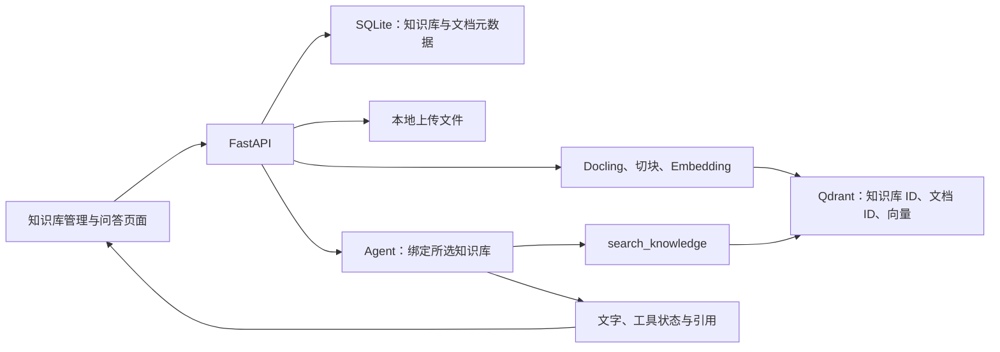

# Henan RAG 多知识库管理技术方案

版本：1.3

状态：多知识库实现方案；按用户最新要求，从新存储开始，不迁移历史资料。

设计日期：2026-10-11

基于版本：`5fb1ba3`（现有 Agent 检索工具、SSE 流式回答与工具调用展示）。

## 1. 目标与范围

第一版支持创建和管理多个知识库，将文档分别上传到指定知识库，并在问答时选择一个或多个知识库作为检索范围。继续使用现有 Docling、Embeddings、Qdrant、Agents SDK 与 Docker Compose。

本次实现包括：

- 知识库创建、列表、详情、重命名、描述修改、删除。
- 指定知识库上传文档，按知识库查看、分页和删除文档。
- 在管理页按文档浏览实际存储的分块正文、payload 和向量预览。
- 单库与多库检索，普通问答和流式问答使用相同范围。
- 引用显示知识库名称、文件名称与文本片段。
- SQLite 元数据持久化、必要的失败清理和重启恢复。
- 对应的接口、服务、前端与 Docker 端到端验证。

本次不包含多用户、组织、登录、权限系统、共享授权、持久聊天会话、历史对话上下文、后台任务队列、文档移动、文档版本管理、混合检索或重排序。页面保留现有单次问答形式；“挂载知识库”指本次请求的检索范围，不复制文档或向量。

## 2. 核心决策

| 项目 | 第一版决定 | 原因 |
| --- | --- | --- |
| 标识 | `knowledge_base_id` 使用 UUID；创建后不可改变 | 重命名不影响文档和向量 |
| 文档归属 | 一份文档归属一个知识库 | 上传和删除行为清楚；同一文件可分别上传到不同库 |
| 问答范围 | 必须明确传入至少一个知识库 ID，不设固定数量上限 | 空选择不会退回全部知识库 |
| 元数据 | SQLite，文件位于 `/app/data/metadata.sqlite3` | 复用现有挂载目录，减少新服务和依赖 |
| 向量存储 | 新建 `henan_rag_knowledge_chunks` 一个集合 | 通过 payload 过滤组合检索多个库，从空存储开始 |
| 多库召回 | 所选库的并集，统一相似度排序，取全局 top-k | 一次问题 embedding、一次 Qdrant 查询，逻辑容易验证 |
| top-k | 保留默认 5，范围 1 至 12 | 是所有选中知识库合计的条数，不是每库条数 |
| 上传执行 | 保留请求内完成的现有流程 | 本次聚焦知识库管理；补齐状态与清理，不引入任务队列 |
| 部署 | 一个 app 实例、一个 Uvicorn worker | 第一版使用进程内写操作锁；后续扩展进程前需要替换锁机制 |
| 默认库 | 自动创建“默认知识库”，可以重命名，禁止删除 | 保留可靠的首次使用入口 |
| 旧 API | 前后端一起升级，移除旧文档路由 | 不继续把 `tenant_id` 混同于知识库 ID |

`tenant` 表示“租户”，通常对应公司或组织，本功能统一使用“知识库”。新请求和新向量不再写入 `tenant_id`，不实现历史兼容映射。

## 3. 改造前的实现与改造点

改造前的 `QueryRequest` 只有一个 `tenant_id`；上传、查询、文档列表和删除都使用它过滤 Qdrant。文档列表通过一次 `scroll(limit=10000)` 聚合向量，不能覆盖完整分页。入库中途失败只删除原文件，可能残留已写入的向量。

本次改为：



SQLite 是知识库存在性、名称、文档归属和文档状态的权威来源。Qdrant 是检索索引。名称不作为查询标识，也不冗余到每个向量里。

挂载数量不设固定上限。服务端一次打开 SQLite 连接，在同一个读取快照中按每批最多 500 个参数获取所选知识库，保持请求顺序并检查全部库的状态。候选文档复核只把有限的候选文档 ID 放入 SQL，再使用所选知识库 ID 集合核对归属，避免大量知识库超过 SQLite 参数限制。

## 4. 数据模型

### 4.1 知识库

| 字段 | 类型 | 规则 |
| --- | --- | --- |
| `id` | UUID 字符串 | 新建时生成 UUID v4；不可修改 |
| `name` | 字符串 | trim 后 1 至 80 字符；拒绝控制字符 |
| `name_key` | 字符串 | 对 name 做 NFKC + casefold；唯一约束 |
| `description` | 字符串 | trim 后最多 500 字符，默认空字符串 |
| `is_default` | 布尔 | 仅系统默认库为 true |
| `status` | 枚举 | `active`、`deleting`、`delete_failed` |
| `last_error` | 可空字符串 | 删除失败的可读原因，不包含凭证 |
| `created_at` / `updated_at` | UTC 时间 | ISO 8601，统一使用 Z 后缀 |

知识库名称唯一；大小写和兼容字符标准化后相同也视为重名。删除未完成时名称仍被占用。展示原始 trim 后名称，不用 `name_key` 展示。

默认知识库固定 ID：`00000000-0000-4000-8000-000000000001`。即使默认库已经改名，初始化也不能把名称改回去。

### 4.2 文档

| 字段 | 类型 | 规则 |
| --- | --- | --- |
| `id` | UUID 字符串 | 全局唯一，沿用现有文档 ID |
| `knowledge_base_id` | UUID 字符串 | 外键，创建后归属不变 |
| `source` | 字符串 | 经过现有规则清理的文件名称 |
| `storage_path` | 可空字符串 | 相对于 upload_dir 的文件路径，不允许绝对路径或越界 |
| `file_available` | 布尔 | 原文件是否存在 |
| `status` | 枚举 | 见后文状态机 |
| `chunk_count` | 非负整数 | 仅 ready 文档参与知识库的已入库计数 |
| `last_error` | 可空字符串 | 解析失败、清理失败或删除失败说明 |
| `created_at` / `updated_at` | UTC 时间 | 实际记录创建和修改时间 |

文档状态：`importing`、`ready`、`failed`、`cleanup_required`、`deleting`、`delete_failed`。

`failed` 表示残留已清理，用户可以重新上传。`cleanup_required` 表示残留还未清理完成。两者均不可检索。第一版重新上传生成新文档 ID，不实现文件去重。

### 4.3 SQLite DDL

```sql
CREATE TABLE IF NOT EXISTS knowledge_bases (
    id TEXT PRIMARY KEY,
    name TEXT NOT NULL,
    name_key TEXT NOT NULL UNIQUE,
    description TEXT NOT NULL DEFAULT '',
    is_default INTEGER NOT NULL DEFAULT 0 CHECK (is_default IN (0, 1)),
    status TEXT NOT NULL DEFAULT 'active'
        CHECK (status IN ('active', 'deleting', 'delete_failed')),
    last_error TEXT,
    created_at TEXT NOT NULL,
    updated_at TEXT NOT NULL
);

CREATE UNIQUE INDEX IF NOT EXISTS idx_one_default_knowledge_base
    ON knowledge_bases(is_default) WHERE is_default = 1;

CREATE TABLE IF NOT EXISTS documents (
    id TEXT PRIMARY KEY,
    knowledge_base_id TEXT NOT NULL REFERENCES knowledge_bases(id) ON DELETE RESTRICT,
    source TEXT NOT NULL,
    storage_path TEXT,
    file_available INTEGER NOT NULL DEFAULT 1 CHECK (file_available IN (0, 1)),
    status TEXT NOT NULL CHECK (status IN (
        'importing', 'ready', 'failed', 'cleanup_required', 'deleting', 'delete_failed'
    )),
    chunk_count INTEGER NOT NULL DEFAULT 0 CHECK (chunk_count >= 0),
    last_error TEXT,
    created_at TEXT NOT NULL,
    updated_at TEXT NOT NULL
);

CREATE INDEX IF NOT EXISTS idx_documents_kb_created
    ON documents(knowledge_base_id, created_at DESC, id);
CREATE INDEX IF NOT EXISTS idx_documents_kb_status
    ON documents(knowledge_base_id, status);

```

连接初始化设置 WAL、`foreign_keys=ON`、`busy_timeout=5000`。这些连接设置必须在每个连接上应用。同步 SQLite 工作通过 `asyncio.to_thread()` 执行，在该线程内创建和关闭连接，不跨线程共享连接。事务只包围短数据库操作，不跨越模型、Qdrant 或文件解析的 await。

SQLite 连接的线程限制和事务行为按 [Python 3.12 sqlite3 文档](https://docs.python.org/3.12/library/sqlite3.html)实施。本文明确使用 `autocommit=sqlite3.LEGACY_TRANSACTION_CONTROL`、`isolation_level=None`，由 repository 显式执行 `BEGIN IMMEDIATE` / `COMMIT` / `ROLLBACK`，避免混用隐式事务与显式事务。

### 4.4 Qdrant payload

```json
{
  "knowledge_base_id": "16c9a3cb-8558-4c0a-a096-339b7119dd05",
  "document_id": "762eae8a-c8c0-4a37-9a6f-926b4d512f69",
  "source": "产品说明.md",
  "text": "这里是片段原文",
  "chunk_index": 0,
  "indexing_state": "ready"
}
```

为 `knowledge_base_id`、`document_id`、`indexing_state` 创建 keyword payload 索引。集合已存在时也要检查并补齐索引；不能因集合存在而提前返回。

`indexing_state` 只有 `staging`、`ready`，用于屏蔽部分入库的数据。文档的完整状态保存在 SQLite。

## 5. API 契约

### 5.1 通用规则

- UUID 统一转换为标准小写字符串；无效 UUID 返回 422。
- 创建/修改请求和 QueryRequest 使用 `extra='forbid'`；不接受 `tenant_id` 作为别名。
- 分页使用 `limit`（默认 50，范围 1 至 200）和 `offset`（默认 0，非负）。
- 列表按 `created_at DESC, id ASC` 排序；默认知识库在知识库列表中排第一。
- 时间使用 UTC；页面自行显示本地时间。
- 知识库列表显示 active 与删除失败记录，选择器只允许 active。
- 未知 ID 返回 404；已进入删除流程的库返回 409，不能静默忽略。

### 5.2 知识库与文档接口

| 方法 | 路径 | 输入 | 成功响应 |
| --- | --- | --- | --- |
| GET | `/api/knowledge-bases` | 分页参数 | 200，分页知识库列表 |
| POST | `/api/knowledge-bases` | `{name, description?}` | 201，知识库详情 |
| GET | `/api/knowledge-bases/{kb_id}` | 无 | 200，知识库详情与计数 |
| PATCH | `/api/knowledge-bases/{kb_id}` | `{name?, description?}`，至少一项 | 200，更新后的详情 |
| DELETE | `/api/knowledge-bases/{kb_id}` | 无 | 204，无响应体 |
| GET | `/api/knowledge-bases/{kb_id}/documents` | 分页参数 | 200，文档分页列表，包含各处理状态 |
| POST | `/api/knowledge-bases/{kb_id}/documents` | multipart `file` | 201，已入库文档 |
| DELETE | `/api/knowledge-bases/{kb_id}/documents/{document_id}` | 无 | 204，无响应体 |

删除文档必须按“知识库 ID + 文档 ID”校验归属，不允许凭文档 ID 跨库删除。默认知识库不可删除，但可以删除里面的文档。

知识库返回对象：

```json
{
  "id": "16c9a3cb-8558-4c0a-a096-339b7119dd05",
  "name": "产品文档",
  "description": "产品使用说明和常见问题",
  "is_default": false,
  "status": "active",
  "last_error": null,
  "document_count": 3,
  "chunk_count": 48,
  "created_at": "2026-10-11T08:00:00Z",
  "updated_at": "2026-10-11T08:00:00Z"
}
```

`document_count` 与 `chunk_count` 仅统计 ready 文档，使用 SQLite 聚合得到，不扫描向量库。文档返回 `document_id`、`knowledge_base_id`、`source`、`status`、`chunk_count`、`file_available`、`last_error`、时间，不暴露 storage_path。

知识库列表外层：`{items, total, limit, offset, default_knowledge_base_id}`。文档列表外层：`{items, total, limit, offset}`。PATCH 支持清空 description，但不支持空 name，不支持修改 ID、is_default、status。

### 5.3 检索与问答

继续使用 `POST /api/retrieve`、`POST /api/chat`、`POST /api/chat/stream`，请求统一为：

```json
{
  "question": "产品限制和部署要求分别是什么？",
  "knowledge_base_ids": [
    "16c9a3cb-8558-4c0a-a096-339b7119dd05",
    "b623e11a-d457-481c-b242-61b0d3e22636"
  ],
  "top_k": 5
}
```

验证规则：question trim 后 1 至 4000 字符；knowledge_base_ids 必填，至少一项、不设固定数量上限，禁止重复；top_k 为 1 至 12。不传、空列表、重复 ID、无效 UUID 均返回 422。任一 ID 不存在或不可用时整个请求失败，不缩小范围继续执行。top_k 限制的是最终证据条数，与知识库数量无关。

`/api/retrieve` 保持返回片段数组。每个 RetrievedChunk 增加 `knowledge_base_id` 和 `knowledge_base_name`，保留 point_id、document_id、source、chunk_index、text、score。

`/api/chat` 返回 `{answer, citations, knowledge_bases}`，其中 knowledge_bases 是本次选择的 `{id, name}` 快照。流式 done 采用相同对象；不持久化会话。

### 5.4 错误响应

普通 HTTP 错误统一为：

```json
{
  "detail": {
    "code": "KNOWLEDGE_BASE_NOT_FOUND",
    "message": "所选知识库不存在，请刷新列表后重新选择。",
    "retryable": false
  }
}
```

| 状态 | code | 触发条件 |
| --- | --- | --- |
| 404 | `KNOWLEDGE_BASE_NOT_FOUND` / `DOCUMENT_NOT_FOUND` | 不存在或文档不属于该库 |
| 409 | `KNOWLEDGE_BASE_NAME_EXISTS` | 标准化后的名称重复 |
| 409 | `DEFAULT_KNOWLEDGE_BASE_PROTECTED` | 删除默认库 |
| 409 | `KNOWLEDGE_BASE_NOT_ACTIVE` | 库已进入删除流程 |
| 409 | `KNOWLEDGE_BASE_BUSY` | 同库存在另一个上传或删除操作 |
| 413 | `UPLOAD_TOO_LARGE` | 超过现有 20 MB 默认上限 |
| 422 | `VALIDATION_ERROR` / `INGEST_FAILED` | 输入不合法或解析失败 |
| 502 | `MODEL_FAILED` | 模型调用失败 |
| 503 | `INDEX_OPERATION_FAILED` / `METADATA_UNAVAILABLE` | Qdrant 或元数据操作失败 |

入库失败的 detail 额外携带已建立记录的 document_id，方便前端刷新并定位失败记录。具体异常记服务端日志；响应不原样泄露连接凭证和内部文件路径。FastAPI validation exception handler 输出同样结构，可附字段错误列表。

SSE 开始后不能修改 HTTP 状态，使用 `error {code, message, retryable}`，保留现有终止语义：失败不发 done。

### 5.5 旧接口处理

移除 `GET /api/documents`、`POST /api/ingest/file`、`DELETE /api/documents/{document_id}`，旧路由返回 404。旧 QueryRequest 的 tenant_id 返回 422。前端与后端同一版本部署，README 示例一起更新；不把旧 tenant 字符串当成新 UUID 自动猜测。

## 6. 多知识库检索与 Agent

### 6.1 检索范围

路由在创建 SSE 响应前验证全部知识库 ID，并保存 `{id, name}` 请求快照。工具执行前再次检查库是否仍 active；如果等待模型期间库被删除，用流内 error 终止。

查询向量生成一次，Qdrant 过滤条件为：

```python
models.Filter(
    must=[
        models.FieldCondition(
            key="knowledge_base_id",
            match=models.MatchAny(any=knowledge_base_ids),
        ),
        models.FieldCondition(
            key="indexing_state",
            match=models.MatchValue(value="ready"),
        ),
    ]
)
```

MatchAny 表示同一字段匹配选中 ID 的任意一个，适合表达知识库并集。[Qdrant 过滤文档](https://qdrant.tech/documentation/search/filtering/)同时建议为过滤字段建立 payload 索引。

初始取 `3 * top_k` 个候选（最多 36），按返回顺序处理；通过 SQLite 一次批量检查这些候选的文档归属、ready 状态和知识库 active 状态，去掉无效记录及重复 point_id，最终最多返回 top_k 条。无有效候选时返回空数组。

这一步用于处理 SQLite、Qdrant 非原子写入期间的短暂不一致。候选补取只做这一轮，过滤后可以少于 top_k，不承诺每个库一定有命中，也不承诺 ANN 是精确最近邻查询。

第一版不做每库配额、轮流抽取、重排序或多轮补查。一个知识库可能占据全部高分结果。界面区分“选择了哪些库”与“实际引用了哪些库”，后续通过评测决定是否增加均衡策略。

### 6.2 Agent 工具

`search_knowledge` 的模型可见参数仍然只有 question。knowledge_base_ids、top_k 和名称快照来自服务端闭包，模型不能扩大检索范围。

保留一次检索、tool_choice=auto、parallel_tool_calls=False、max_turns=3 和已完成的事件顺序保护。工具返回示例：

```text
[证据 1] 知识库：产品文档；来源：产品说明.md（chunk 2）
这里是片段原文。

[证据 2] 知识库：技术资料；来源：部署要求.md（chunk 0）
这里是另一个知识库的片段原文。
```

引用编号基于最终全局结果顺序生成；回答、工具文本和 citations 使用同一列表，不分别排序。名称仅作为资料标签，不作为额外模型指令。

### 6.3 SSE 扩展

现有事件名称与关键字段保持：status、tool_start、tool_end、citations、text_delta、done、error。

- tool_start 增加 knowledge_bases：本次选择的 ID 和名称列表。
- tool_end 增加 hits_by_knowledge_base：`[{id, name, chunk_count}]`，包含 0 命中的已选库。
- citations 中每条证据增加知识库 ID 和名称。
- done 增加 knowledge_bases，包含全部所选库，不局限于有命中的库。
- call_id、chunk_count、elapsed_ms 和真实文字增量行为继续保留。

已经检索完成的回答使用本次证据快照。生成期间知识库被重命名或删除，不撤回已发送文字；后续新查询使用新的状态和名称。

## 7. 入库、删除和一致性

### 7.1 写操作并发约束

每个知识库使用一个进程内 mutation guard。上传文档、删除文档、删除知识库竞争同一个标识；获取失败立即返回 409，不排队占用长时间 HTTP 请求。使用生命周期内的 `set[str]` 保存 busy ID，在单 event loop 中不含 await 地完成“检查 + 加入”，进入后在 finally 移除；不使用不存在的 asyncio.Lock.acquire_nowait 方法。

重命名采用短 SQLite 事务，不持有长期解析锁。查询不等待上传锁，通过索引和元数据状态屏蔽未完成文档。

文档操作进入锁后再次检查库和文档状态，避免校验与写入之间发生删除。第一版不能通过增加 Uvicorn worker 绕过此约束。

共享 DocumentConverter 的 convert 阶段使用全局 semaphore（并发 1），避免未经验证地并发调用同一解析器；等待者不持有 SQLite 事务。其余知识库的删除、管理和问答仍可运行。后续提高解析并发需独立解析器或验证线程安全及内存占用。

### 7.2 上传

1. 检查库 active、文件名和大小，获取库的写锁。
2. 创建 document_id 和 importing 元数据记录，记录预定 storage_path，file_available 初始为 false。
3. 写入原文件后更新 file_available=true；继续 Docling、切块和分批 embedding 流程。
4. 批量 upsert，payload 带 knowledge_base_id，indexing_state=staging。
5. 全部批次成功后，按“库 ID + 文档 ID”将 payload 改为 ready，wait=True。
6. SQLite 事务将文档改为 ready，并保存最终 chunk_count；成功后返回 201。
7. 任一步失败，先按“库 ID + 文档 ID”删除向量，再删除原文件。清理完全成功时标记 failed、chunk_count=0、file_available=false；任何清理失败时标记 cleanup_required，并按文件实际存在性记录 file_available。

Qdrant 更新 payload 可以只修改指定字段而保留其他字段，按 [Qdrant payload 文档](https://qdrant.tech/documentation/manage-data/payload/)实施 set_payload，不使用 overwrite_payload。

步骤 5 与 6 之间可能出现 Qdrant ready、SQLite importing 的短暂状态；检索的 SQLite 检查会排除它。异常和 asyncio.CancelledError 都走清理逻辑，清理任务使用受控 shield 并等待完成；进程被强制终止则由启动恢复处理。

### 7.3 删除文档

1. 获取所在库写锁，校验文档确实属于该库。
2. 标记 deleting，立即从新查询可检索文档集合中排除。
3. 按库 ID + 文档 ID 删除 Qdrant points，wait=True。
4. 删除已登记的原文件，文件不存在视为已完成。
5. SQLite 删除文档记录。

失败标记 delete_failed，继续隐藏于检索，DELETE 同一路径可重试。不根据用户传入名称拼路径。执行文件删除前 resolve 路径并验证仍处于 upload_dir 内。

### 7.4 删除知识库

前端展示库名、文档数量和“会删除其中的文档与向量”的确认提示；仅在用户明确确认后调用 DELETE。

后端步骤：获取写锁 → 检查非默认库 → 标记 deleting → 删除该库全部 Qdrant points → 删除登记原文件 → 在一个 SQLite 事务中删除文档、知识库。成功返回 204。

失败保留 delete_failed 和待清理元数据，不恢复为 active；管理页显示“重试删除”。重复请求已完全删除的 ID 返回 404，重试未完成的删除继续执行幂等清理。

### 7.5 重启恢复

启动恢复处理残留：

- importing / cleanup_required：清理对应向量与文件；成功改 failed，并说明上次处理被中断。
- deleting / delete_failed 文档：重新执行幂等删除。
- deleting / delete_failed 知识库：重新执行幂等删除，优先于其文档恢复。

恢复失败保留不可检索状态并记录错误；不因一个坏记录阻止所有健康知识库使用。每次外部清理调用设置超时，启动恢复设置总预算 30 秒；超出预算的记录保留状态，后续在页面继续删除，不无限阻塞启动。

SQLite 本身暂时不可写时，无法保证立即记录新错误；保留已提交的 importing/deleting 状态，写服务端日志，待数据库恢复后由恢复流程继续处理。

SQLite、Qdrant 和文件系统之间没有跨系统事务。本方案通过状态、重试与查询校验实现可恢复一致性，不声称三者原子提交。

## 8. 前端交互

### 8.1 页面结构

同一个 URL 内划分“聊天”和“知识库管理”两个 Tab，默认显示聊天；仅显示当前 Tab 的内容，沿用现有原生 HTML/JS，不引入前端框架。Tab 切换只改变可见性，不销毁表单、已收到的回答、工具记录或后台上传/问答任务。

管理区域：库列表（名称、描述、已入库文档数、chunk 数、异常状态）→ 当前管理库详情 → 上传控件及该库文档列表。提供新建、修改名称/描述、删除操作。

deleting/delete_failed 知识库提供“继续删除”，删除状态文档和 cleanup_required 文档提供“清理/继续删除”，调用现有 DELETE 路径；这些操作只在后端 mutation guard 空闲时执行。failed 文档可以删除记录或重新选择文件上传，不提供伪造的原文件重试。

问答区域：知识库多选框 → 已选范围标签 → 问题输入 → 只看召回 / Agent 回答 / 停止生成 → 回复 → 工具调用 → 引用。

库和文档列表都使用服务器分页；管理列表翻页不影响已选问答范围。选择器从 active 库分页加载，可继续加载下一页；不能只用第一页建立可选范围。

### 8.2 状态规则

- `activeManagementKnowledgeBaseId`：管理与上传目标，一个 ID。
- `selectedChatKnowledgeBaseIds`：问答范围，至少一个 ID，不设固定数量上限。
- 两者独立：切换管理库不会悄悄改变问答范围。
- 首次进入页面默认管理默认库，问答默认勾选默认库。
- 问答选择存在 localStorage；加载后与现存 active 库核对并移除失效项。首次访问才自动勾选默认库；已保存的空选择保持为空。
- 保存范围可能包含不在第一页的库；加载完整分页列表后核对已有选择，不能依据当前管理列表页把它们误判为不存在。加载循环不限制固定页数，但必须检查空页、重复页和未前进的 offset。
- 无选择时禁用“只看召回”和“Agent 回答”，提示“请选择至少一个知识库”。
- 上传开始时捕获目标 ID 和名称；进行中禁止管理目标切换及重复上传，响应始终归到原目标。
- 问答执行期间禁止修改挂载范围，保留停止生成行为。
- 删除库后刷新列表并移除对应选中 ID；没有剩余选择时不自动切到其他库。
- 重命名后更新列表和标签，ID 不变；已经显示的回答保留请求快照标签。
- 接口发现范围已失效时刷新选择器并提示，不自动替换范围重试。

所有名称、描述、文件名、错误和证据通过 textContent 展示。api helper 正确处理 204 空响应和新的 detail 对象；SSE 保留现有 UTF-8、CRLF、网络分片和取消处理。

工具展开示例：“挂载：产品文档、技术资料；召回：产品文档 3 条、技术资料 0 条；耗时 0.8 秒”。0 命中不代表没有挂载。

## 9. 从新存储开始

用户已明确历史资料无需保留或迁移，本次不实现迁移模块、映射表、迁移状态和旧数据扫描。

- 新默认集合为 `henan_rag_knowledge_chunks`，原集合不参与新请求。
- 新上传目录为 `/app/data/knowledge-uploads`，避免旧文件进入新的文档列表。
- 元数据位于 `/app/data/metadata.sqlite3`，初始化只建立知识库、文档两张表及默认库。
- 本机 `.env` 同步到上述路径，模型配置和密钥继续保留。
- app 初始化新集合，补齐过滤字段索引，随后即可使用；无需先执行迁移命令。
- 第一版不自动清空已有的新知识库；Docker 重启仍保留已经创建的库和文档。

旧资料的物理清理可独立执行，不是新功能启动的前提。默认部署复用现有 Qdrant volume，但使用不同 collection。新增知识库 ID 和文档 ID 不依赖旧 tenant_id。

## 10. 模块与配置改造

| 文件 | 实现职责 |
| --- | --- |
| `schemas.py` | 知识库/文档 DTO、分页模型、新 QueryRequest、引用新字段 |
| 新增 `metadata_repository.py` | SQLite 初始化、短事务、CRUD、计数、分页、状态持久化 |
| `rag_service.py` | 库管理、范围校验、写锁、上传状态、删除恢复、多库检索、工具和引用扩展 |
| `app.py` | 新路由、统一错误、生命周期初始化与恢复、SSE 前置校验、移除旧路由 |
| `static/index.html` | 库管理界面、多选、分页、独立状态、错误与引用展示 |
| `config.py` / `.env.example` | METADATA_DB_PATH 默认 `/app/data/metadata.sqlite3`；显式 upload_dir 配置说明 |
| `.gitignore` | 忽略 data 下 SQLite 主文件、-wal、-shm 和运行数据/备份；保留上传目录 .gitkeep |
| `README.md` | 新界面、API、存储恢复和默认库说明 |
| 根 README | RAG 项目介绍更新为多知识库与可选范围问答 |

Compose 继续挂载 `./data:/app/data`，不新增服务。元数据 repository 使用 Python 标准库 sqlite3，不增加数据库依赖。保持服务端口 8002 和 Qdrant Dashboard 6335。

repository 不依赖 FastAPI 和模型客户端；服务层负责业务规则，路由负责 HTTP 映射。service 的关键签名：

```text
create_knowledge_base(name, description) -> KnowledgeBase
update_knowledge_base(id, name?, description?) -> KnowledgeBase
delete_knowledge_base(id) -> None
resolve_scope(knowledge_base_ids) -> list[KnowledgeBaseReference]
ingest_file(filename, content, knowledge_base_id) -> DocumentSummary
list_documents(knowledge_base_id, limit, offset) -> DocumentPage
delete_document(knowledge_base_id, document_id) -> None
retrieve(question, knowledge_base_ids, top_k) -> list[RetrievedChunk]
answer_stream(question, knowledge_base_ids, top_k, *, knowledge_bases=None) -> AsyncIterator[Event]
answer(question, knowledge_base_ids, top_k, *, knowledge_bases=None) -> ChatResponse
```

实现所有新增/修改函数时继续保留中文前置注释：用途、每个参数、返回或产出、关键副作用。

## 11. 实施顺序

| 步骤 | 工作 | 完成条件 |
| --- | --- | --- |
| 1 | 元数据 schema、repository、默认库与分页 | 重启后名称/ID/归属保留，计数准确 |
| 2 | 新存储配置与初始化 | 独立向量集合和上传目录，重启不重置新数据 |
| 3 | 管理路由、状态、写锁、删除与恢复 | 单库操作正确，错误不会误删其他库 |
| 4 | 上传归属、staging、失败清理 | 半完成和失败文档不可检索 |
| 5 | QueryRequest、多库过滤、引用和 SSE | 单库不串库，多库有正确来源，流式行为保持 |
| 6 | 前端管理、多选、分页、交互状态 | 上传目标与问答范围独立且清晰 |
| 7 | Docker 验收与 README | 下列验收全部通过并保留测试结果 |

步骤 1 至 6 在同一功能版本内集成；旧前端不与新请求 schema 混用。新存储用合成资料完成端到端验证。

## 12. 测试与验收

### 12.1 自动测试

| 类别 | 必测场景 |
| --- | --- |
| 元数据 | 默认库初始化幂等；唯一默认库；名称 trim/NFKC/casefold；重名；PATCH 空字段；持久化与分页 |
| 归属 | A 库文档不能从 B 库删除；单库查询不返回 B；多库不返回未选 C |
| 输入 | 无 ID、空列表、重复、超过 8 项仍有效、未知 ID、删除中 ID、旧 tenant_id、无效 UUID |
| 上传 | ready 前不可查；第二批 embedding/upsert 失败回收第一批；取消与文件失败；清理失败保留状态 |
| 删除 | 默认库保护；只删所选库；文件缺失；Qdrant/文件/SQLite 失败；重复重试；中途重启恢复 |
| 并发 | 同库上传与删除返回忙；不同库可独立操作；重命名不改变 ID；查询校验状态 |
| 初始化 | 空安装、重复启动、新集合与旧集合独立；已有新库不会因启动而被清空 |
| 检索 | 一次 embedding；MatchAny 范围与 ready 条件；元数据过滤；全局 top-k；空库；来源名称 |
| 流式 | 流式回归测试升级范围参数；call_id 对应、事件顺序、引用、范围与分库命中、取消、非流式一致 |
| 前端 | 管理/问答状态独立；多选/零选择/分页；删除选中库；上传中切换；204/新错误对象；UTF-8 SSE 分片 |

保留现有 4 项切块测试。服务测试用临时 SQLite 和受控模型/Qdrant 替身；Docker 集成测试使用独立 collection 和临时 data，不能清空用户现有集合。

### 12.2 Docker 端到端验收

1. 创建 A“产品资料”、B“技术资料”、C“其他资料”，记录不同 UUID；刷新与重启后仍存在。
2. 分别上传合成文档：A 包含“青禾平台版本为 3.2”，B 包含“部署最低内存为 8 GB”，C 包含无关信息。
3. 只选 A，检索产品版本；所有证据归属 A。
4. 只选 B，检索部署内存；所有证据归属 B。
5. 同时选择 A、B，问版本和内存，观察真实工具调用、流式输出与两库来源；C 的任何证据均不得进入。准备简短明确的测试文本，并以召回归属断言与模型回答核对分别验收。
6. 选空库仍完成工具调用并说明资料不足；不选库时页面不能发送，直接请求返回 422。
7. 重命名 A 后 UUID、文档和向量数量不变，新回复引用新名称。
8. 删除 A 的一个文档，确认向量和原文件清除，B 不受影响；随后删除 A，选择器移除它。
9. 默认库删除返回 409；错误知识库归属的文档删除返回 404。
10. 运行上传失败与删除失败的故障注入测试，重启后验证残留不可检索、清理可恢复。
11. 重启服务，确认新知识库、文档与向量仍存在；旧 collection 不影响查询范围。
12. 对所有 Qdrant 查询与删除核查范围字段，仓库运行时代码无 tenant_id 依赖（旧参数拒绝测试和说明除外）。

### 12.3 交付标准

- API 文档与实现一致，输入和错误行为有测试。
- Docker 正常启动，元数据和向量持久化；SQLite 文件未进入 Git。
- 页面可以独立管理上传目标和聊天挂载范围。
- 单库、多库、引用、工具状态、停止生成完整可用。
- 新旧存储分开；新数据重启后保留，不会自动重置。
- Ruff、pytest、前端验证及 Docker 端到端验收通过。
- README 提供使用、新存储、失败恢复和备份说明。

### 12.4 文档分块浏览

新增 `GET /api/knowledge-bases/{knowledge_base_id}/documents/{document_id}/chunks`，在知识库管理 Tab 内点击“查看分块”使用。查看只读取已入库数据，不重新解析文件，也不调用 Embeddings 或聊天模型。

- 先检查知识库 active、文档存在并归属所选库，文档必须 ready；非 ready 返回 `409 DOCUMENT_NOT_READY`，跨库文档返回 404。
- Qdrant 过滤同时绑定 `knowledge_base_id`、`document_id` 与 `indexing_state=ready`。为 `chunk_index` 建 INTEGER payload 索引，按该字段升序读取。
- `limit` 为 1 至 100，网页每页 12 块；`offset` 是起始 chunk_index。查询多取一条判断是否有下一页，`next_offset` 从最后一条实际索引加 1 计算，支持索引空洞。
- 响应包含知识库名称、文档摘要、实际匹配总数和当前页 chunks。每块提供 point ID、chunk_index、正文、字符数、索引状态、实际 payload、向量实际维数及前 8 个数值。
- 向量维数从存储记录读取，不能用当前 Embeddings 配置替代历史记录。实际匹配总数和文档元数据计数同时显示，便于发现存储不一致。
- 查询前后核对元数据，文档或知识库进入删除状态后不返回旧结果；不展示内部原文件路径。
- 前端以目录和全文查看器呈现，元数据可折叠；小屏改为纵向布局。正文和 JSON 使用纯文本节点，避免执行用户上传的 HTML 或脚本。
- 页内加载、失败重试、空数据状态与管理写操作协调；切库、删文档或删库使旧详情失效，乱序成功或失败响应均不得覆盖新详情。切换聊天 Tab 保留当前浏览位置。

自动验收覆盖稳定分页、索引空洞、库与文档隔离、实际存储字段、未 ready 状态、索引服务异常，以及前端请求乱序、删除失效和纯文本显示。Docker 验收上传超过一页的合成文档，逐页核对全部块与 Qdrant 的实际 payload 和向量。

## 13. 已知边界与后续演进

第一版以单机单 worker 为边界，SQLite、文件和 Qdrant 分别持久化。数据分组不是安全权限；当前本地服务保持 localhost 绑定。

多库 top-k 允许一个库占满结果，需要以后用问题集评测是否增加每库候选配额与重排序。一个文档只归一个库；跨库复用、文档移动与版本更新可另行设计。

将来增加后台入库、多进程或多节点时，替换进程内锁为跨进程协调机制，并评估 PostgreSQL 与对象存储。当前 repository/service 分层为这些变化保留接口，不在本次实现中提前引入。

技术依据仅用于核对 API 能力，本文的数据模型、接口约束、范围和验收标准是针对本项目的设计决定。实现时对现有 Qdrant v1.16.3 与锁定客户端做实际集成验证，不直接套用更高版本新增配置。
